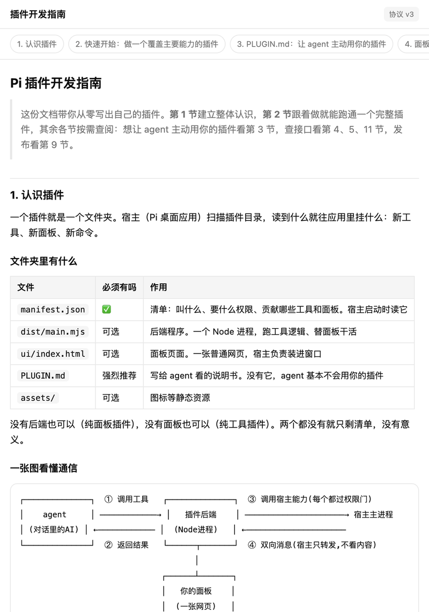

# PiWork-Plugin-Docs

[简体中文](README.md) | English

**Official PiWork plugin · Plugin development docs · `com.pi.devdocs`**

The plugin development guide, readable inside the PiWork client. It covers the full path from building your first plugin to publishing it in the marketplace: the manifest spec, panel API, backend `ctx`, tools, cards, commands, settings, debugging, and releasing.

It is itself a **minimal pure-UI plugin**: `manifest.json` + one static page, with no backend and no build step — the panel is just a web page. If you want to see the smallest possible plugin, look at this one.

## The docs panel in PiWork



## What is in the panel

| Chapter | Content |
| --- | --- |
| Understanding plugins | Folder layout, communication model, host / plugin responsibilities, and contribution points |
| Quick start | Build a “sticky note” plugin from scratch, adding tools, a panel, panel → agent, and chat cards in four stages |
| PLUGIN.md | How to get the agent to use your plugin proactively; `description` should say *when to use*, not *what it is* |
| Panel development | Panel / workspace / backend relationships, theme adaptation, native slots and popup menus |
| Backend reference | Callbacks, `ctx`, every capability (`ctx.call`), `agent.turnEnd`, the underlying protocol |
| Debugging and testing | Logs, loading plugin source, testing the backend without the app, common pitfalls |
| Scheduled tasks | Long-lived backends, missed firings, and the “is the user still there” question |
| Permissions | Permission gates and declarations |
| Publishing | Packaging, tags, release assets, icon rules |
| manifest field reference | Panels, tools, commands, context injection, settings, cards, messages, file preview, skills |
| Pre-release checklist | Items to confirm before listing |

## Install and open in PiWork

1. Open the PiWork desktop app.
2. Right panel → **Plugin Center** → **Plugin development docs** → Install.
3. Choose **Plugin development docs** from the **Open plugin** menu.

You can also simply tell the agent “I want to write a plugin”; it will usually point you to this panel.

## Document source (single source of truth)

The content is `docs/plugin-dev-guide.md` in this repository, synced into the panel by a script:

```bash
npm install
npm run sync:docs    # docs/ → ui/docs/, and vendors marked into ui/lib/
```

**Do not edit files under `ui/docs/` directly** — the next sync overwrites them.

## Adding a document

1. Write the Markdown under `docs/` in this repository
2. Add an entry to the `DOCS` catalogue in `ui/app.js`
3. Add a line to the sync list in `scripts/sync-devdocs.mjs`
4. Follow the release process below

## Release

1. `npm run sync:docs` (if the docs changed)
2. Bump `version` in `manifest.json`
3. Commit and push a `v<version>` tag (or Actions → Release → Run workflow)

Release assets: `com.pi.devdocs-<version>.zip` + `index.json`.

## Layout

| Path | Purpose |
| --- | --- |
| `manifest.json` | Plugin manifest (pure UI: no backend, no tools) |
| `docs/plugin-dev-guide.md` | Document source (single source of truth) |
| `ui/` | Panel page (`ui/docs/`, `ui/lib/` are sync outputs) |
| `assets/` | Runtime icons |
| `media/` | README demo assets (not shipped in the release) |
| `scripts/sync-devdocs.mjs` | Document sync |
| `scripts/release.mjs` | Packaging + single-entry index generation |

## Links

- [PiWork](https://github.com/PiWorkAgent/PiWork) — the host app
- [PiWork-Registry](https://github.com/PiWorkAgent/PiWork-Registry) — marketplace index
- [Plugin development guide](./docs/plugin-dev-guide.md) — the same source as the panel content
- [PLUGIN.md](./PLUGIN.md) — the agent-facing usage guide
