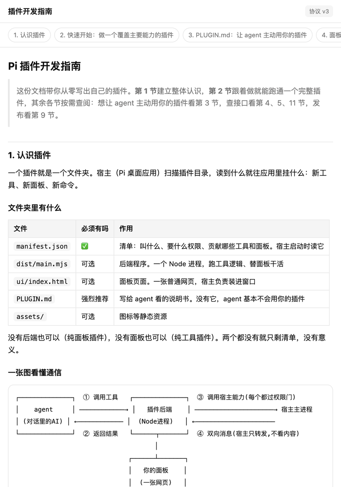

# PiWork-Plugin-Docs

[English](README.en.md) | 简体中文

**PiWork 官方插件 · 插件开发文档 · `com.pi.devdocs`**

在 PiWork 客户端内直接阅读的插件开发指南。正文覆盖从零做出一个插件、到发布上架的完整流程：manifest 规范、面板 API、后端 `ctx`、工具、卡片、命令、设置、调试和发布。

它自己就是一个**最小的纯 UI 插件**：`manifest.json` + 一张静态网页，没有后端、没有构建步骤——面板就是一张网页。想知道一个插件最少需要什么，看它就行。

## PiWork 中的文档面板



## 面板里有什么

| 章节 | 内容 |
| --- | --- |
| 认识插件 | 文件夹结构、通信模型、宿主与插件分工、能挂进应用的贡献点 |
| 快速开始 | 从零做一个「便签」插件，分四步加工具、面板、面板 → agent、对话卡片 |
| PLUGIN.md | 怎么让 agent 主动使用你的插件；`description` 应该写「什么时候用」 |
| 面板开发 | 面板与工作区 / 后端的对应关系、主题适配、原生槽和弹出菜单 |
| 后端参考 | 回调、`ctx`、全部能力（`ctx.call`）、`agent.turnEnd`、底层协议 |
| 调试与自测 | 看日志、加载插件源码、不启动应用单独测后端、常见坑 |
| 定时任务 | 长生命周期后端、错过触发和「用户还在不在」的判断 |
| 权限参考 | 权限门与声明方式 |
| 发布到市场 | 打包、tag、Release 资产、图标规范 |
| manifest 字段总表 | 面板、工具、命令、上下文注入、设置、卡片、消息、文件预览、技能 |
| 发布前检查清单 | 上架前逐项确认 |

## 在 PiWork 里安装与打开

1. 打开 PiWork 桌面端。
2. 右侧栏 →「插件中心」→「插件开发文档」→ 安装。
3. 在「打开插件」菜单里选「插件开发文档」。

也可以直接对 agent 说「我想写一个插件」，它通常会引导你打开这块面板。

## 文档来源（单一事实源）

正文是本仓库的 `docs/plugin-dev-guide.md`，由脚本同步进面板：

```bash
npm install
npm run sync:docs    # docs/ → ui/docs/，并 vendor marked 到 ui/lib/
```

**不要直接改 `ui/docs/` 下的文件**——下一次同步会覆盖。

## 新增一篇文档

1. 在仓库 `docs/` 下写好 md
2. 在 `ui/app.js` 的 `DOCS` 目录加一项
3. 在 `scripts/sync-devdocs.mjs` 的同步清单加一行
4. 走下面的发布流程

## 发布

1. `npm run sync:docs`（如果改了文档）
2. 改 `manifest.json` 的 `version`
3. 提交并推送 tag `v<version>`（或 Actions → Release → Run workflow）

Release 资产：`com.pi.devdocs-<version>.zip` + `index.json`。

## 目录

| 路径 | 说明 |
| --- | --- |
| `manifest.json` | 插件清单（纯 UI：没有 backend、没有 tools） |
| `docs/plugin-dev-guide.md` | 文档源文件（单一事实源） |
| `ui/` | 面板页面（`ui/docs/`、`ui/lib/` 是同步产物） |
| `assets/` | 运行时图标 |
| `media/` | README 演示素材（不进入发布包） |
| `scripts/sync-devdocs.mjs` | 文档同步 |
| `scripts/release.mjs` | 打包 + 生成单条目索引 |

## 相关链接

- [PiWork](https://github.com/PiWorkAgent/PiWork) — 宿主应用
- [PiWork-Registry](https://github.com/PiWorkAgent/PiWork-Registry) — 插件市场索引
- [插件开发指南](./docs/plugin-dev-guide.md) — 与面板正文相同的源文件
- [PLUGIN.md](./PLUGIN.md) — 写给 agent 的使用说明
